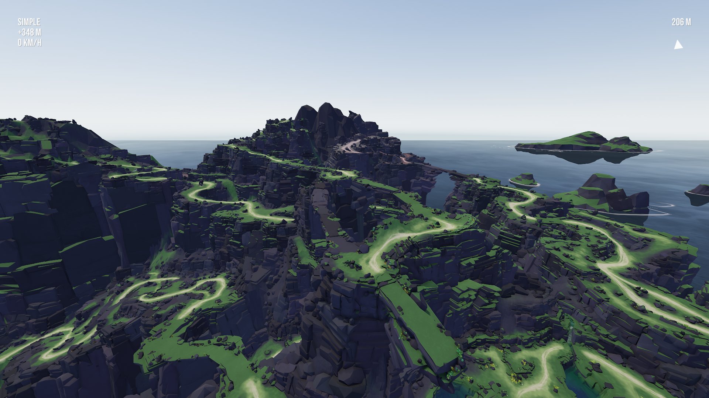
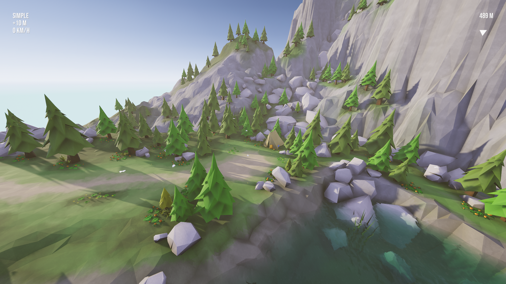
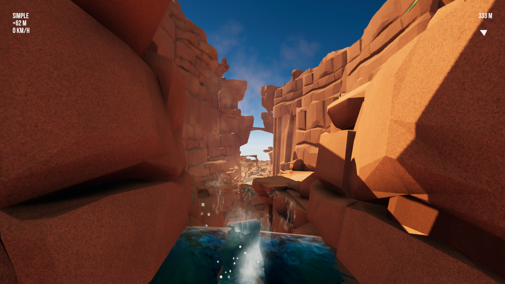

# LMD Drone

Fly an FPV drone in Lonely Mountains: Downhill. A [MelonLoader](https://github.com/LavaGang/MelonLoader) mod.

Stop anywhere on the trail and launch your drone in the sky, then see the world live from its camera.

**Simple** holds its height and stops when you let go.  
**Advanced** is a simulated FPV quad in rate mode.

[Controls](#controls) · [Flying](#flying) · [Install](#install) · [Settings](#settings) · [Notes](#notes)

 

Watch the demo on [YouTube](https://youtu.be/VEN03Tf54Uk)

<table>
<tr>
<td width="50%"></td>
<td width="50%"></td>
</tr>
</table>

 

## Controls

The drone is only available when the bike is stopped on the ground, and during a break at a resting place.

| Gamepad | Keyboard | |
|:---|:---|:---|
| Y (X in a break) | X | Launch |
| B | Backspace | Back to the bike |
| X | Tab | Switch between Simple and Advanced |
| View | H | Readout and hints on / off |
| D-pad ↑ ↓ | R / F | Camera tilt: tap for a step, hold to sweep |
| R3 | G | Camera tilt back to its start |

| Simple | Normal | Alternate | Keyboard |
|:---|:---|:---|:---|
| Climb, descend | Left stick ↑ ↓ | Right stick ↑ ↓ | Space / Left Shift |
| Turn | Left stick ← → | Right stick ← → | Q / E |
| Fly | Right stick | Left stick | W A S D |
| Faster | RT | RT | C |
| Slow, soft turns | LT | LT | V |

| Advanced | Normal | Alternate | Keyboard |
|:---|:---|:---|:---|
| Throttle | Left stick ↑ ↓ | Right stick ↑ ↓ | Space / Left Shift |
| Yaw | Left stick ← → | Right stick ← → | Q / E |
| Pitch | Right stick ↑ ↓ | Left stick ↑ ↓ | W / S |
| Roll | Right stick ← → | Left stick ← → | A / D |

L2 and R2 do nothing in Advanced, as on a real quad. A quad left on its back on the ground rights itself after a moment.

Gamepads are read through XInput: Xbox pads, or others through Steam Input.

 

## Flying

**Simple** can't crash: it slides along what it touches.

**Advanced** tops out around 125 km/h. A hit at over 8 m/s ends the flight and puts you back at the bike, and softer hits bounce it off. Switching to Simple levels it.

The whole mountain is open. Near the edge of the map the picture breaks up with static and the drone is pushed back.

The bike can't be touched while you fly, and flying doesn't start the clock. If the clock is already running, it keeps running.

 

## Install

1. Open the game folder (Steam: right-click the game → Manage → Browse local files).
2. Download `MelonLoader.x64.zip` (0.7) from the [MelonLoader releases](https://github.com/LavaGang/MelonLoader/releases) and extract it into the game folder. Use the zip, not the installer: the installer can pick the wrong build for this game. Start the game once, then quit.
3. Extract the LMD Drone zip from the releases page into the game folder.
4. Start the game, stop on a trail and press Y.

 

## Settings

Settings are in `UserData\LMDDrone.cfg`, where each one is explained. F11 reloads the file while playing.

| Setting | Default | |
|:---|:---|:---|
| `StickLayout` | Normal | Normal: left stick climbs and turns, right stick flies. Alternate: the other way round |
| `AltitudeFrom` | Camp | What the readout's height is measured from: the mountain's finish camp, or the bike |
| `FlightMode` | Simple | Simple or Advanced |
| `Volume` | 0.5 | Of the motors, 0 to 1 |

 

## Notes

- Grass, flowers and bushes don't stop it. Trees and rocks do.
- It casts a shadow if the game's shadows are on.
- The model and the motor sound are made by the mod: the game has none.
- Problems: the log is `MelonLoader\Latest.log`, this mod's lines start with `[LMD_Drone]`.

 

## Building

You need the game with MelonLoader (started once) and a .NET SDK 6 or newer. `.\build.ps1` builds the mod and puts the release zip in `dist\`; `-Install` also copies the DLL into the game's `Mods` folder.

 

## Credits

- **Megagon Industries** for the game.
- **LavaGang** for [MelonLoader](https://github.com/LavaGang/MelonLoader).

 

## License

MIT, see [LICENSE](LICENSE). Not affiliated with Megagon Industries.
